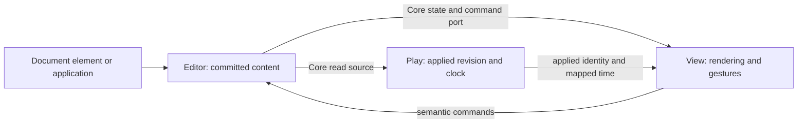

# Document-owned editing

Status: accepted design (P0, 2026-10-13); P1 Score Core/API/Headless delivered
and verified on 2026-10-15. P2 Score bindings and piano-roll editing are
implemented. P3 Audio sequence/history, playback, loading, waveform editing,
range processing and WAV export are implemented; current verification belongs to
STATUS. P4 staff input was implemented under DEC-054 and then removed by
[DEC-058](../DECISIONS.md#dec-058--score-editing-moves-to-a-dedicated-grid-view),
which moves Score note editing to `<score-grid-view>` and makes `<score-view>`
read-only.
Related decisions: [DEC-053](../DECISIONS.md#dec-053--document-owned-editing-and-borrowed-playback),
[DEC-055](../DECISIONS.md#dec-055--editing-is-a-view-feature-not-a-capability), which
places editing inside View rather than a separate capability, and
[DEC-057](../DECISIONS.md#dec-057--editable-documents-are-an-api-not-a-web-component),
which replaces the document Web Components with loading APIs, and
[DEC-058](../DECISIONS.md#dec-058--score-editing-moves-to-a-dedicated-grid-view).
[STATUS](../STATUS.md), EDIT-01, owns delivery; the
[dated proposal](../plans/2026-10-13-editing-capabilities.md) retains the original
P0–P8 baseline. The current five-phase roadmap is below. This document specifies
the complete target; public references describe only implemented members.

Layer and entry: domain Core contracts plus View: operations and contracts in the
`/view` API, and editors with their URL loaders in `/view/headless` (implemented
for Score and Audio); Elements only borrow an editor through `.editor`. Audio sequence rendering and
WAV export belong to the `/play` export API. There is no Edit capability.
Source reuse starts with [ScoreEditSession](../../packages/score/src/core/model/ScoreEditSession.ts),
[ClipEditSession](../../packages/audio/src/core/model/ClipEditSession.ts),
[Score playback](../../packages/score/src/core/playback.ts), and the existing
[Score](PLAY-COMPONENTS.md) / [Audio](AUDIO-PLAY-COMPONENTS.md) players.
Public references and demos ship with the corresponding implementation, using
the [documentation templates](../docs/README.md).
The Score surface is documented in the [View API](../../apps/doc/webmusic/src/content/docs/score/api/view.mdx)
and [ScoreEditor](../../apps/doc/webmusic/src/content/docs/score/headless/view/score-editor.mdx)
references. Score bindings are described by the
[native player](../../apps/doc/webmusic/src/content/docs/score/headless/play/score-player.mdx)
and the [grid View](../../apps/doc/webmusic/src/content/docs/score/element/view/score-grid-view.mdx).
Audio public contracts are documented in the [View API](../../apps/doc/webmusic/src/content/docs/audio/api/view.mdx),
[AudioClipEditor](../../apps/doc/webmusic/src/content/docs/audio/headless/view/audio-clip-editor.mdx)
and the [Play export API](../../apps/doc/webmusic/src/content/docs/audio/api/play.mdx).
## User task and boundary

The first Score workflow imports MIDI, edits authored notes in a piano roll,
undoes/redoes, displays the same content as staff notation, auditions the applied
revision and exports MIDI. The first Audio workflow loads a single file, edits
a contiguous sequence, applies gain/fades or explicit local processing,
undoes/redoes, auditions and exports WAV.

Score notes are edited on the dedicated `<score-grid-view>` piano-roll grid;
the existing waveform renderer gains optional editing interaction for Audio.
`<score-view>` is read-only and can follow an editor's content. Staff and
notation editing are outside the current contract (DEC-058). Complete engraving,
performance-only note editing, seamless live replacement, spectral repair,
multi-track arrangement, cross-document history, persistence and collaboration
are separate work. An editable surface does not imply those capabilities.

## Composition and authority

| Owner | Responsibility | Borrowed resources |
|---|---|---|
| `ScoreEditor` / `AudioClipEditor` | One authoritative current document, transactions, content revisions, optional local history and interaction sessions | Injected loaders/processors; no player or clock |
| Domain Core | Immutable models, source/command ports, semantic operations, position maps and asset-reader contracts | No DOM or Play/View implementation |
| Play | Applied snapshot, preparation, scheduler, transport, audible state and revision acknowledgement | Read-only document source; never commits edits |
| View | Layout, viewport, focus, hit testing, tool interaction and draft overlays | Core editor port and optional player source/time |
| `loadScoreEditor` / `loadAudioClipEditor` | Load one file and create its editor for the application to own | Domain loading adapter; no Element or renderer |
| Application | Project workflow, persistence, global history and cross-document transactions | Domain commands/checkpoints |
| Bridge | Reusable cross-domain conversion and coordination | Domain contracts; no application project/history ownership |



Editors implement `ScoreEditorPort` / `AudioClipEditorPort`, extending the
read-only `ScoreDocumentSource` / `AudioDocumentSource` ports. Play accepts only
the read-only interface. `createScoreEditor` and `createAudioClipEditor` create
Headless owners; existing short-lived edit sessions remain batch primitives.
History roots, drafts and the last applied playback snapshot are retained data,
not additional authorities that may commit content.

Score editing in View may depend on Core and I/O. Audio's editing API and
Headless editor depend only on Core and injected ports. Play and Analyze never
import the concrete editors; editable View surfaces borrow them through the Core
ports. UI uses neutral structural bindings and imports neither domain
nor Kernel types. Do not extract shared Kernel history before both domains
establish a useful common implementation.

## Inputs, outputs and units

| Item | Contract and default |
|---|---|
| Source snapshot | `{ documentId, documentRevision, contentId, content }`; Score content is a Score, Audio content is a sequence |
| Identity | A new import/replacement gets a new `documentId`; edits/undo retain it. IDs are opaque and instance-isolated |
| Revision | Starts at zero; every effective commit, undo or restore increments monotonically. No-op and selection changes do not increment |
| Content identity | Identifies an immutable root; undo may restore an old `contentId` at a newer revision. Saved identity, not revision equality, determines dirty state |
| Expected base | Commands carry both `documentId` and `expectedRevision`; stale commands fail, without implicit rebase |
| Score editing time | Exact rational quarters as reduced integer `[numerator, denominator]` pairs; denominator positive |
| Audio editing time | Nonnegative safe-integer frames; ranges are half-open. Seconds are only display/Play boundary conversions |
| Read subscription | Registers before delivering the initial snapshot, then delivers ordered snapshots; unsubscription is idempotent and does not dispose the owner |
| Readiness | Empty, loading, ready, error and disposed are distinguishable. A ready zero-length Audio sequence is not a missing document |

Source publication is reentrancy-safe: a subscriber never receives an older
revision after a newer one. Async requests carry an attachment generation as
well as document identity/revision. Invalid data, unknown operation versions,
out-of-bounds ranges and unsupported structures return typed failures; no
partial commit or silent fallback occurs.

## Commands, history and interaction sessions

`execute` accepts a versioned, serializable atomic envelope. For example:

```json
{
  "version": 1,
  "documentId": "example-document",
  "expectedRevision": 7,
  "label": "Move notes",
  "operations": [
    { "type": "move-notes", "noteIds": ["note-a"], "deltaQuarters": [1, 4] }
  ]
}
```

Operations run in order against a private candidate. The complete result must
validate before one publication. Newly inserted objects include their IDs in
the submitted operation; replay must not silently generate different identities.
A synchronous transaction builder cannot nest or cross `await`; exceptions
abort it. Results are `committed`, `noop` or `failed`, with a stable error code
such as `revision-conflict`. Async processing also reports `superseded` or
`cancelled`. A commit reports from/to revision, content identity, affected
IDs/ranges, operations and a composable position map. A synchronous command
invoked during publication fails with `reentrant-command`; a subscriber may
schedule it after its callback, never nest a commit inside the active publication.

Local history defaults to **100 committed transactions**, across undo and redo;
`history: false` disables it. One gesture or batch is one history item. Net-zero
edits preserve redo and create no item; an effective edit after undo discards
the redo branch. Undo/redo restores immutable roots at a new revision and emits
the corresponding map. History trimming is observable in history state.
`markSaved` records the current content identity without changing revision.

For application history, an immutable checkpoint/restore path does not record a
local undo entry; restoring clears both local undo and redo stacks, and still validates, increments revision, emits a change and supplies a
map or explicit reset policy. A restore event identifies its origin so an
application need not record its own undo as another action. Checkpoints carrying
Audio assets hold explicit leases until released. This is in-memory integration,
not a project persistence format or a cross-document atomic transaction.

Each View creates an interaction session by default; callers can explicitly share
one to share selection. Selection retains surviving IDs or maps Audio ranges;
it is not restored as content history and does not mark content dirty. Focus,
hover, tool and viewport stay local to each View. Drafts are based on a revision,
remain outside committed content, and are visible only through the initiating
session unless explicitly shared.

## Score policies

The first operations are insert, delete, move, resize, transpose, set/clear
velocity override and quantize. They target authored note IDs, not playback
occurrence IDs. New notes use written time; a copied/split note receives a new
ID. Piano-roll polyphony does not silently become fully filled notation voices.
Partial tie/tuplet/grace edits requiring structural repair fail as unsupported
until semantic group commands exist. Untouched structures remain valid.

An **effective musical timing edit** (move, resize or quantize) makes written
time authoritative for each changed note: remove any absolute `performed`
overlay, preserving its previously resolved velocity in `velocityOverride`
when removing that overlay. Notes without an overlay retain their existing
velocity representation.
Sounding onset/end then come from the Score TimeMap at the new quarter endpoints;
duration is the difference of those conversions, including interior tempo
changes. Pitch-only, velocity-only and no-op timing edits preserve performed
timing. Untouched imported microtiming remains untouched.

A move retains the existing Duration, dots and ratio. Simple-note resizing uses
the requested exact quarter duration. Negative onset, nonpositive ordinary-note
duration, invalid pitch or velocity rejects the entire batch. Quantization uses
an explicit positive rational grid and origin; nearest-grid ties round forward.
The default editing grid is a sixteenth note (one quarter of a quarter note).
The first pitch display/edit mode is written pitch. Concert-pitch mode must
explicitly apply and reverse Part transposition once before it is enabled.

Edits keep written notation readable. Transposing by whole octaves keeps step and
accidental; other intervals keep a flat spelling for flat notes and otherwise use
sharps, without double accidentals. Resize, quantize and insert store a length
that one whole-through-64th value with up to two dots can write as that base and
dots, so staff entry can address it; other lengths keep a dotless exact base.
Written pitch edits must also sound inside MIDI 0–127 after Part transposition.
Velocity overrides apply only to sounding chain heads: a numeric override on a
rest or a tie continuation rejects, while clearing remains allowed. Deleting one
endpoint of an authored slur, or part of a well-formed beam group, rejects rather
than leaving a dangling partner. Results name only notes whose content changed,
and an entry that would only regenerate identities is a no-op.

Add optional `NoteData.velocityOverride` (integer 1–127), retaining the existing
numeric `Note.velocity` getter. Effective velocity resolves as
`velocityOverride ?? performed?.velocity ?? 80`; `noteVelocity` and consumers
describing effective velocity use that same rule. Setting velocity never creates
performed timing. Keep all existing PerformedAttributes members required.

P1 emits Score JSON **v0.2**. The new reader
accepts/migrates v0.1 and the existing unmarked legacy input, while rejecting
unknown marked versions. Do not emit a new field under the old version where an
old reader could silently discard it. Cover constructors, `with`, serialization,
cloning/repeats, analysis and MIDI export together. The schema version is
independent of npm package versions. MIDI's existing lossy-event diagnostics
remain required; editing does not promise preservation of unsupported CC/bends.

## Audio sequence and processing policies

Audio uses a contiguous immutable sequence from the first editor. The sequence
has an output sample rate and ordered channel layout, plus asset/silence segments
and document annotations. Segment order determines position; there is no stored
`timelineStart`, track ID, implicit gap or overlap. Empty output is valid;
zero-length segments are removed. Structural changes do not materialize PCM.

| Kind | Stored content |
|---|---|
| Asset descriptor | Stable asset ID, decoded sample rate, channel layout and frame count; PCM lives in an asset store |
| Asset segment | Stable segment ID, asset ID, source start/end frames, finite nonnegative gain (default 1) and local gain envelope |
| Silence segment | Stable segment ID and positive frame count |

The first successfully decoded asset determines output format; an initially
empty document requires explicit format. Mono/stereo layouts are explicit;
additional unlabeled channels use indexed layouts, without guessing surround
semantics. P0 selects one-to-one source/document frames: incompatible sample rate
or channel layout fails with `incompatible-audio-format`. An explicitly selected
normalization adapter may create a compatible asset before insertion. No implicit
resampling or channel mixing occurs during paste.

Initial commands include splice, split, trim, insert silence, set gain/fade,
copy/cut/paste and explicit range processing. A split creates new segment IDs
sharing the source asset. Envelope points use segment-local frame boundaries
with linear interpolation. Split/trim crops and rebases envelopes and inserts
boundary values; it does not restart a fade. Source bounds and all summed output
lengths must remain safe integers. Existing Region remains an annotation/cue/span,
not a playback clip placement. Document annotations use output frames and declare
content-attached or fixed-position anchoring; legacy seconds use an explicit
adapter. Existing Clip Region semantics do not change incidentally.

An asset reader copies a requested bounded range into caller-owned planar
Float32Array buffers; it never exposes mutable backing PCM. The in-memory adapter
may reuse AudioClip's internal range-copy mechanism. History, clipboard and
checkpoints store roots/references, never a full PCM snapshot per edit.

`ClipEditSession` remains an existing materializing API. Editor processing uses
it, or another injected processor, only on an explicit selected range to produce
a new asset. The request names processor ID/version, parameters, range and expected
revision, with AbortSignal supplied out of band; function-valued Web Audio effects
are not serialized into command history. An adapter declares required input handles, output length,
latency compensation and tail policy before processing. An incompatible or
undeclared result fails. Initial default replaces exactly the selected length,
compensates declared latency and trims tails; extending output requires an
explicit requested tail policy and a resulting splice/map.

Only one materializing job per editor runs by default. A newer document revision,
replacement or disposal cancels it; late output cannot commit and releases its
asset lease. After validating output, commit a serializable asset-backed splice
with fixed IDs and retain its output asset. History/checkpoint replay restores
that result; it does not rerun potentially nondeterministic DSP or recreate an
AbortSignal/context. Export explicitly renders the requested snapshot and format; editing
or playback acknowledgement never secretly renders the whole sequence.

## Position maps and playback application

Both domains map from the **last applied playback revision** to the requested
revision, composing across skipped commits, undo/redo and failed preparation.
Active bindings retain or accumulate the needed maps independently of history
trimming. A map declares its domain/identity and endpoint affinities. If a valid
chain cannot be supplied, reset to origin, clear the loop and report
`positionPolicy: "reset-origin"`; never preserve coordinates by coincidence.

Audio deletion `[a,b)` shifts surviving positions at/after `b` left by `b-a`;
positions inside the deletion collapse to `a` with a deleted marker. Insertions
shift later positions; endpoints at the insertion follow explicit left/right
affinity. The playhead follows surviving content; a collapsed anchor uses left
affinity. Undo cannot infer an original position lost by collapse. A new explicit
seek/stop is new transport intent, not undone with content.

Content-attached points inside deletion disappear; spans trim or disappear.
Undo restores them from the content root. Fixed-position annotations retain
their numeric frames, clamped to the new end. Mapped loop endpoints that become
empty or inverted disable the loop, without substituting a full-document loop.

Score note edits retain the musical playhead quarter position, clamped to the
new extent. Native unexpanded playback converts old nominal seconds through the
old TimeMap to musical position, maps it, then converts with the new TimeMap.
Repeat-expanded input without a verified authored/occurrence map uses the
reset-origin policy. Document-coordinate seeking and occurrence overlays remain
unavailable there; passive followers may still show the actual expanded playback
snapshot. Do not infer authored IDs by parsing repeat suffixes.

Play Headless exposes `setDocumentSource(source | undefined)`; the Element
`.editor` property adapts to that same binding. Binding state contains requested
and applied document identity/revision, `empty | preparing | ready | error`, and
an attempt generation and the failure/position policy where relevant. `waitForDocumentRevision` observes
the current requested revision and settles `applied | superseded | failed`;
detachment/disposal settles pending requests as superseded. A future unrequested
revision fails as unknown; an obsolete target returns superseded. Applied means
that exact target is the active playback content at settlement, not merely that
the editor committed it.

`retryDocumentApplication()` starts a fresh attempt for the current requested
revision and returns its application outcome. Previous failed results stay
terminal; new waiters observe the new attempt. Reassigning the same source alone
is a no-op, not an implicit retry. Detachment clears the document binding and
does not silently select an old independent source.

The first application protocol is:

1. Capture a content request and transport generation, pause playback, cancel
   future scheduled work and release active voices.
2. Prepare a candidate without disturbing the editor or publishing false applied
   identity. Superseding requests cancel/release old candidates.
3. Atomically adopt candidate content, mapped position and valid transport state;
   publish applied identity only after adoption. Preserve rate, gain/pan and
   valid loops. Stay paused; resuming requires an explicit later play command.
4. On failure, retain edited content and last applied snapshot, expose error and
   gate `play()` until a successful retry or explicit detach. Never undo an edit
   to conceal preparation failure or audition stale content as current.

`play()` while preparing fails as not ready, without queuing a hidden resume.
Stop, seek, rate and loop commands during preparation advance transport intent;
the latest valid intent wins, and cannot be overwritten by captured state.
Positions are tagged with their source revision for mapping. A post-request stop
keeps eventual content at origin while it remains the latest position intent;
a later valid seek supersedes it. Applying content never creates/resumes an
AudioContext just to edit. Playback readiness and resource preload remain explicit.

The existing native single-ScorePlayer gains paused timeline adoption, preserving
player, publisher, scheduler/clock reader, synth and graph identity. Scope preload
work by content generation. Replacing the scheduler would strand existing clock
borrowers; raw Element `.score` replacement is not this protocol. Controller/Rack,
TonePlayer and other engines are initially unsupported for document binding.
Preserve existing Score `revision` (publication) and `sourceRevision` (playback
source replacement); add separately named document fields. Static sources have
no fabricated document identity.

Audio Play supplies a segment-aware engine through the existing facade's borrowed
transport path. It consumes Core snapshots/readers and owns one scheduling clock.
The document Play binding creates and owns this engine even though the facade
borrows its transport. Binding replacement, detach or disposal stops/disposes
that engine and releases scheduled/prepared asset leases; borrowed contexts stay
caller-owned. Facade transport detachment alone is not sufficient cleanup.
Its supported loop commands need an explicit transport capability; the current
borrowed path's loop restriction is not assumed solved. Source observation is
discriminated `empty | clip | sequence`, with applied sequence identity/revision.
Same-transport revision changes must publish; `.clip`/`.currentClip` is undefined
for a sequence, never its first asset. Clip-only companions report unavailable;
graph meters can continue, and sequence-aware View reads the sequence directly.
Static PCM analysis uses an explicit render adapter.

## Web Components and source selection

There is no document Web Component (DEC-057). An application creates and owns
the editor through the Headless API, then lends it to Elements through the
`.editor` property. The owning public references list each shipped member.

```js
import {loadScoreEditor} from '@webmusic/score/view/headless';
const editor = await loadScoreEditor('/music.mid');
scorePlayer.editor = editor;
grid.editor = editor;        // <score-grid-view editable>
staff.editor = editor;       // <score-view type="staff">, read-only follow
// …later, after detaching borrowers:
editor.dispose();
```

`loadScoreEditor(url, options)` and `loadAudioClipEditor(url, options)` fetch,
parse or decode one file and create its editor; `createScoreEditor` and
`createAudioClipEditor` wrap content the application already holds. Loading
options combine the existing loader limits, format, AbortSignal and, for Audio,
an injectable decode loader with the editor's history, processing and listener
options. A failed or aborted load rejects and creates no editor.

A View never creates an editor implicitly. `.editor` supplies content and
commands; boolean `editable` (default false) only enables mutation gestures on
the Views that edit: `<score-grid-view>` and `<audio-view>`. `<score-view>` has
no `editable`; with `.editor` it draws the editor's visible content read-only.
Without a ready editor, or for an Audio type that does not support editing,
editable state is explicitly unavailable; no pretend-success gestures occur. Read-only
editor-bound views are supported without playback. Assigning `undefined`
detaches the editor; there is no `editor` selector attribute, so cross-root and
late composition are the application's own object wiring.

An editor combined with independent `.score`/`.clip`, `src`, controller, Rack or
transport source is a `source-conflict`, even if values appear equal. Programmatic
atomic configuration rejects before replacing the last valid binding. Invalid
attribute combinations disable editing/playback and expose conflict until fixed;
retained rendering is marked unavailable. With no editor, existing passive-source
precedence remains unchanged.

An editor-bound View always renders committed document content plus its local
draft. Optional Play contributes time only when applied document identity/revision
matches and the coordinate mapping is valid. During lag, mismatch or failed
application, show playback pending/unavailable and suppress misleading playheads,
active-note overlays and seeking. The same document ID alone is insufficient.

The application decides the document's lifetime. Replacing a document means
loading or creating the new editor, assigning it to every borrower, then
disposing the old one; disposing an editor still assigned makes its borrowers
unavailable. A View or Player disconnect releases its bindings, never a borrowed
editor.

## Interaction and presentation

Pointer interaction emits `editpreview` for a revision-bound draft; completion
submits one semantic command and emits `editcommit` only for a successful commit.
Playback acknowledgement is separate. Escape, pointer cancellation, lost capture,
blur, tool changes, detach or a changed base revision cancel the draft. External
replacement during a drag never applies the old geometry to new content.

Keyboard commands are scoped to the focused editing surface and do not intercept
text fields elsewhere. Arrow/nudge, selection, delete and undo/redo operate through
the same domain commands as pointer input. Provide labels, visible focus and
numeric alternatives to dragging; selection/draft/playing/error states must be
distinguishable beyond color.

### Score grid editing

`<score-grid-view>` (renderer `mountScoreGrid`) draws written-pitch rows with
piano keys, bar, beat and snap lines from the score's time signatures (4/4
before the first), a bar ruler and an optional velocity lane. Without an editor
it draws `.score`, `src` or a player's score; editing needs a ready `.editor`
and `editable`, which shows a one-row icon toolbar along the top of the grid
window. The piano keys, ruler and velocity lane are sticky layers over the
scrolled notes, so they stay in place while the grid scrolls; the gesture
instructions and live status are available to assistive technology but not
drawn, and the numeric note-values panel opens from a toolbar button.

The application chooses which features exist with the `tools` token list —
`move`, `resize`, `draw`, `delete`, `velocity`, `snap`, `zoom`, `history`;
absent means all. A missing feature hides its toolbar control and makes its
gestures, keys and numeric fields inert; selection is always available while
editing. The user chooses, within those features, the pointer tool (`select`
or `draw`), snap (`off`, `1/4`, `1/8`, `1/8t`, `1/16`, `1/16t`, `1/32`; a
note value, default `1/16`), the velocity lane and horizontal/row zoom. These
settings are also `tool`, `snap`, `velocity-lane`, `pixels-per-quarter` and
`note-height` attributes; a user change is reflected and announced with
`gridsettingschange`, and an attribute change applies without remounting.

| Gesture | Feature | Command |
|---|---|---|
| Click / Shift-click / drag empty space (Select) | always | Selection only |
| Drag a note body | `move` | One `move-notes` + `transpose-notes` draft, clamped at quarter 0 and MIDI 0–127 |
| Drag a note's right edge | `resize` | `resize-notes`, never shorter than one snap step |
| Draw tool click/drag empty; Select double-click or Alt-drag | `draw` | `insert-notes`, one snap step or the dragged length |
| Draw tool click on a note | `delete` | `delete-notes` |
| Drag a velocity-lane stem | `velocity` | One `set-velocity` per selected note, committed together |
| Arrow keys / Shift+Left/Right | `move` / `resize` | One snap step or semitone |
| Delete, Ctrl/Cmd+Z/Y, B | `delete`, `history`, `draw` | Delete, undo/redo, toggle the draw tool |
| Ctrl/Cmd+wheel, Alt+wheel, toolbar zoom | `zoom` | View setting only |

With snap off, positions resolve to 1/96 quarter. Each completed gesture is one
atomic, revision-guarded editor command; a shared interaction session lets a
read-only `<score-view>` show the grid's draft. The collapsible note-values form
offers every enabled edit without a pointer.

UI work covers a neutral two-dimensional item grid, draggable range handles and
envelope-lane presentation. Bindings supply hit IDs, numeric axes and legal
operations; domain code owns pitch, snapping, timing and edit validity. Reuse
existing timeline/envelope presenters before adding public names. Discrete note
velocity and continuous gain/automation have different value semantics even when
they share drawing. Use public `--wm-*` tokens, parts and named handles; do not
make a fixed toolbar or application workstation layout mandatory.

### Score sheet editing

Under DEC-060 `<score-sheet-view>` (renderer `mountScoreSheet`) is the notation
editing surface, modeled on the interaction of notation programs such as
MuseScore; it shares no code with them. It engraves justified systems on pages
(`layout="page"`) or in a column (`layout="flow"`) with the package's VexFlow
staff engraver. Editing needs a ready `.editor` and `editable`; `tools` offers
`pitch`, `input`, `duration`, `tie`, `accidental`, `delete`, `history` and
`zoom` (absent means all). Selection and Left/Right navigation are always
available while editing.

| Input | Feature | Command |
|---|---|---|
| Click / Ctrl/Cmd-click / Shift-click a notehead or rest | always | Selection only; Shift selects the range in the voice |
| Up/Down, Ctrl/Cmd+Up/Down, Alt+Shift+Up/Down, dragging a notehead | `pitch` | `set-pitches`: semitone spelled in the key, octave, diatonic step; a drag is one draft |
| N, A–G, 0, click on a staff in input mode | `input` | `write-notation` at the input cursor, which then advances |
| 1–7 and `.` with a selection | `duration` | `write-notation` keeping the event's pitches and IDs |
| `+` | `tie` | `tie-notes`; in input mode a tied `write-notation` + `tie-notes` |
| Flat / natural / sharp buttons | `accidental` | `set-pitches` with that alteration |
| Delete, Backspace | `delete` | `notes-to-rests` |
| Ctrl/Cmd+Z/Y | `history` | Undo/redo |

The four operations act locally on the named events and never rebuild a whole
measure, so editing works inside scores with beams, slurs, chords, several
voices and tuplets elsewhere. Pitch and delete work on tuplet notes. Rewriting
a tuplet or grace rhythm, writing across a barline or starting inside a
sounding note is refused with `unsupported-structure`; the sheet shows the
reason in its toolbar and emits `editerror`. Chord entry, voice selection,
tuplet entry and ties drawn across system breaks are not offered yet.

## Resources, limits and failures

| Resource | Ownership and initial limit |
|---|---|
| Audio assets | Asset store retains deduplicated immutable PCM; current roots, history, clipboard, active playback and jobs hold explicit leases |
| History-only audio assets | Default 256 MiB; prune oldest history until within budget. Count only assets retained solely by history, once per asset; never release live current content to satisfy this budget |
| Clipboard | One immutable selection snapshot per editor by default; replace/clear/dispose releases its leases |
| Prepared playback chunks | Default 64 MiB total allocation budget including inactive, candidate and active chunks; evict inactive LRU entries, bound lookahead and reserve capacity before pinning/scheduling. Fail preparation if the budget cannot be met. Never cache a full rendered sequence per revision |
| DSP/export | Explicit job-owned buffers/assets and cancellation; bound input/output before allocation and report limit failure |
| Contexts, workers and subscriptions | Creator releases owned resources; injected resources stay caller-owned. Repeated cleanup and partial failure release every acquired handle |

History limits are configurable and history can be disabled. The history-only
budget is not a cap on current-document, external checkpoint or total browser
memory. Audio load retains the existing loader limits; total decode, assets,
playback cache, history, jobs and export are measured separately. Structural
edits/undo must not read whole PCM; playback adoption must not render full output.

`loadAudioClipEditor` in `view/headless/load-audio-clip-editor.ts` imports
`loadClipFromUrl` from `play/api/load.ts` over the existing View-to-Play edge.
Its default loader sets `streaming: false`, forwards AbortSignal and resource
limits, and creates no implicit AudioContext. Native decoding, when needed, uses
a caller-injected loader closure with its borrowed context. Default codec
availability remains the existing loader's capability. `loadScoreEditor`
imports the Score I/O loader on demand.

## Implementation and reference delivery

The current roadmap has five phases, P0–P4. The consolidation changes task
grouping, not the ownership or acceptance contracts. [STATUS](../STATUS.md)
identifies current work and verified delivery; phase numbering here does not
claim completion.

| Phase | Deliverable | Mapping from the dated proposal |
|---|---|---|
| P0 | Accepted document, history, timing, playback and component contracts | Original P0 |
| P1 | Score Core ports/maps, velocity/schema migration, atomic editing API/Headless commands, history, checkpoints and interaction sessions | Original P1 |
| P2 | Native Score playback revision application, Element `.editor` bindings, and piano-roll editing through import, undo, audition and MIDI export | Original P2–P3 |
| P3 | Audio single-file asset/sequence model, structural history, segment playback, HTML binding, waveform editing, local processing and WAV export | Original P4–P6 |
| P4 | Staff-input keyboard/voice prototype, tag-boundary decision, and notation editing against the shared Score editor; removed by DEC-058, which adds the Score grid View | Original P7 |

Original P8 remains future work beyond these five phases: seamless replacement,
multi-track/project workflows, richer MIDI control editing, spectral repair and
broader DAW integration. P0 changes design owners only; subsequent phases add
real implemented entries without empty tags or allowlists.

When each layer ships, update manifests, tsup mappings, exports/barrels,
registration side effects, [package policy](../../scripts/package-policy.mjs),
[architecture checks](../../scripts/check-architecture.mjs),
[Element composition](../../scripts/element-composition-policy.mjs), catalogs
and owning public references together. Editing pieces ship inside the existing
View layers (and Audio export inside Play), so they add no capability, entry or
layer of their own. Review format migrations,
optional dependencies and all other surfaces in the
[Architecture policy table](../ARCHITECTURE.md#executable-policy-and-documentation-authority).

## Acceptance

These are phase acceptance requirements. Actual results belong to STATUS and
the owning tests; the table alone does not establish verification.

| ID / phase | Evidence required |
|---|---|
| E1 / P1 | Atomic commands, invalid/stale/no-op batches, exact rational edits, monotonic undo/redo, saved identity, bounded history, reentrant publication and external checkpoints |
| E2 / P1–P2 | Imported performed timing moves audibly and in MIDI export; velocity-only edit does not freeze tempo; untouched microtiming, variable tempo and v0.1→v0.2 round trip are covered |
| E3 / P2 | Native player/clock identity retained; requested/applied distinction; stale/failing prepare, retry attempts, stop then seek during preparation, rate/loop during await and map chains across skipped commits/undo; repeat fallback explicitly reported |
| E4 / P2–P3 | JS object and pure-HTML composition, conflicts, empty/late/ambiguous targets, target removal/reconnect, two isolated documents and repeated disposal |
| E5 / P2–P3 | Pointer and keyboard produce one equivalent commit per gesture; cancellation and external replacement discard drafts; local/shared selection, focus and accessible numeric alternatives work in browser |
| E6 / P3 | Sequence splice/undo shares PCM; allocation instrumentation covers long input, history pruning and leases; exact format rejection, range bounds, silence, envelopes, deletion anchors and lossy undo mapping |
| E7 / P3 | Same-transport sequence source revisions publish; no fake clip or full render per commit; play/loop and WAV export match edited output; stale DSP, latency/tails, cancellation and asset release |
| E8 / P4 | Retired by DEC-058 with staff input; the Core notation-entry operation keeps its own tests |
| E10 / DEC-058 | `<score-grid-view>` draws without an editor; each `tools` feature gates its toolbar control, gestures, keys and numeric fields; draw, marquee, snap/unsnapped move, resize, velocity lane and zoom; settings reflection without remount; read-only `<score-view>` follows an editor and a shared draft |
| E9 / each shipped layer | Exports, dependency/layer checks, public members, demos, snippets and three integration forms match implementation; regression coverage proves old passive use remains valid |

Automated gates establish code/document consistency. Audible playback/export
comparison, pointer/touch behavior, keyboard focus and device behavior need their
own recorded evidence. Documentation acceptance alone does not establish them.
